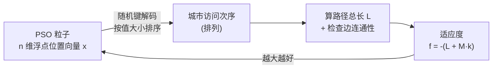

# PSOonTSP —— 用粒子群优化求解 TSP

用一套通用的**连续型粒子群优化（PSO）**去求解**离散的旅行商问题（TSP）**。

核心难点在于：PSO 天然在连续空间 $\mathbb{R}^n$ 中搜索，而 TSP 的解是一个离散排列。本项目通过 **随机键编码（random-key encoding）+ 罚函数法** 把两者桥接起来，并额外做了适应度缓存来减少目标函数调用。

---

## 目录结构

```
PSOonTSP/
├── main.py            # 入口：配置问题/算法参数，跑一次完整求解
├── TSP.py             # TSP 建模：City / TSP / TSPManager（含编码器与目标函数）
└── MyPSO/
    ├── __init__.py    # 对外导出 MyPSO、Particle
    ├── core.py        # PSO 本体：Particle（单粒子） + MyPSO（种群调度）
    └── utils.py       # 预留（当前为空）
```

分工：

| 模块 | 职责 |
| --- | --- |
| `MyPSO/core.py` | 纯优化器，**与 TSP 无关**。只要求提供一个"输入向量 → 越大越好"的 `f_target` |
| `TSP.py` | 纯业务建模，把 TSP 的解空间编码成连续向量，并提供适应度函数 |
| `main.py` | 装配层，把两者接起来 |

这种解耦意味着换一个组合优化问题（如背包、调度）时，`MyPSO/` 不需要任何改动。

---

## 总体思路



1. **编码**：粒子位置 $x \in \mathbb{R}^n$ 的每一维对应一座城市，维度上的**数值大小**决定访问先后 → 得到一个排列。
2. **评价**：把排列当作旅行路线，计算总长度 $L$，并统计"断裂边数" $k$（路线上相邻两城之间没有边，或不以起点开头）。
3. **适应度**：$f(x) = -(L + M \cdot k)$，**最大化** $f$ 等价于最小化 $L$，且不可行解会被惩罚。
4. **搜索**：PSO 在连续空间里照常飞行，编码器实时把每个新位置翻译成一条路线。

---

## 关键设计

### 1. 随机键编码：连续向量 → 离散排列

TSP 的可行解是 $n$ 个城市的一个排列，排列空间上无法直接定义合理的"速度/位置差"。随机键编码的做法是：

- 位置向量 $x \in \mathbb{R}^n$，第 $i$ 维的数值就是"城市 $i$ 的优先级键值"；
- 把键值从小到大排序，得到的下标顺序即访问次序；
- 向量在 $\mathbb{R}^n$ 中连续变化时，排列只在**相邻键值跨越**的瞬间改变 —— 这是一种保序的、不会突然跳跃的映射。

解码实现见 `TSPManager.from_float_score_to_int_path`，思路是反复取"当前最小键值"的下标，取走后把该位置**标记为大于当前最大值的数**，保证本轮循环内不会再被取到：

```python
cur = l_scores.index(min(l_scores))
l_path.append(cur)
l_scores[cur] += max(l_scores) - min(l_scores) + 1   # 抬到严格大于当前最大值
```

> 之所以 `+1`：标记后的值必须**严格大于**所有未标记值（`max - min` 只保证"等于最大值"，会与已有最大值并列，导致 `index(min)` 取到重复下标）。等价且更稳妥的写法是 `np.argsort`，或直接把该位置标记为 `float("inf")`。
>
> 另外，解码结果末尾会补上 `start_idx`，把哈密顿路径闭合为回路。

### 2. 约束处理：罚函数法

解码出来的排列**不一定可行**（稀疏图上很可能出现两座"没有边相连"的城市被排在相邻位置）。项目采用**罚函数法**把约束折进目标函数：

- `check_path_connectivity` 返回"违规次数" $k$：每一条不存在的边 +1，起点不是 `start_idx` 再 +1；
- 适应度取 $f = -(L + M \cdot k)$。

$M$ 的取值不能拍脑袋（太小会让不可行解超过最优可行解；太大也无必要），`build_map` 中的推导是：

$$S = \sum_{i=1}^{n} w_i^{\text{top}}\quad(\text{前 } n \text{ 大的边权之和}), \qquad M = \text{punish\_rate} \times S,\quad \text{punish\_rate}=2$$

理由：一条可行回路恰含 $n$ 条边，其总长 $L \le S$（$S$ 是所有路线长度的上界）；而任何含断裂边的解，其"虚拟长度"至多与 $S$ 同量级。取 $M = 2S > S$ 即可保证**任何可行解的适应度都严格优于任何不可行解**，且不同可行解之间仍按真实路径长度排序。

在 `main.py` 的 5 城算例上，这套机制可稳定收敛到真正的最优解（见下文示例输出）。

### 3. PSO 本体

`MyPSO/core.py` 是标准全局版 PSO：

$$v_i \leftarrow \omega v_i + c_1 r_1 (p_i - x_i) + c_2 r_2 (g - x_i)$$

- **惯性权重线性递减**，前期偏探索、后期偏开发：

$$\omega_t = \omega_{\max} - (\omega_{\max} - \omega_{\min}) \cdot \frac{t}{T}$$

- **速度限幅**：$\lVert v_i \rVert > v_{\max}$ 时按比例缩放到 $v_{\max}$；
- **个体最优 $p_i$ / 全局最优 $g$** 分别在 `Particle.update` 与 `MyPSO.update_population` 中维护；
- **适应度缓存**：`fitness_pos` / `fitness_p_best` / `fitness_g_best` 三个字段缓存已算过的目标值，避免"同一个向量反复求值"。当前 5 城算例下实测约 **1.11 次目标函数调用 / 粒子 / 迭代**（理论下界为 1），比朴素写法（每轮 4 次）快约 3.6 倍。

---

## 运行

```powershell
# 依赖：numpy
```

> 直接从包内运行 `python MyPSO/core.py` 会失败（内部使用相对导入），请始终从仓库根目录运行 `main.py` 或作为包导入。

### 示例输出

```
最优路径访问顺序: [0, 3, 4, 2, 1, 0]
总长度: 23.0
断裂边数: 0
```

三行分别是：解码出的访问次序（首尾闭合）、路径总长、约束违反次数（`0` 表示可行）。该算例的 12 条本质不同的路线中真实最优即为 23.0。

---

## 参数说明（`main.py`）

| 参数 | 含义 | 当前值 |
| --- | --- | --- |
| `START_IDX` | 起点城市 | `0` |
| `N_CITIES` | 城市数（也是向量维度） | `5` |
| `PUNISH_RATE` | 罚项系数倍率 $M = \text{rate} \times S$ | `2` |
| `N_MAX_ITERATION` | 迭代代数 | `50` |
| `N_PARTICLES` | 种群规模 | `50` |
| `C1` / `C2` | 自我认知 / 群体学习因子 | `2` / `2` |
| `OMEGA_MIN` / `OMEGA_MAX` | 惯性权重下/上界 | `0.4` / `0.7` |
| `MAX_VEL` | 速度范数上限 | `0.7` |

`test_case_map` 每行是 `[city1, city2, weight]`；`is_digraph=False` 时自动补齐反向边。城市编号必须是连续的 `0 .. n-1`，否则 `build_map` 会抛 `ValueError`。

---

## 适用范围与已知限制

**可靠的部分**：小规模、边较密的图（如 5 城完全图）可以稳定求到最优；整个"连续搜索 → 离散解码 → 评价 → 反馈"的闭环是正确的。

**需要注意的部分**：

1. **稀疏大图上效果退化**。约束是"悬崖式"的：断裂边数从 0 到 1 是巨大跳变，PSO 得不到"往可行域靠"的梯度。49 城稀疏网格图实测难以得到可行解。首选改进是**修复式解码**——按随机键顺序走，每步只在"与当前城市相邻且未访问"的城市里选键值最小者，无解时回退到最近邻；这样任意向量都映射为可行路线，罚项可以退休。
2. **`r1` / `r2` 是"每粒子标量"**（`np.random.rand(n_particles)`），所有维度共享同一个随机数 → 各维同步移动，排列的重排能力受限。改成**每维随机向量**更合理。
3. **位置无边界**，且速度限幅把速度归一化到恰好 $v_{\max}$，粒子可能持续漂移。对随机键解码无害（只依赖相对大小），但加入边界或归一化会让行为更可控。
4. **解码器的标记技巧**在键值量级极大（$\gtrsim 10^{16}$）时会因浮点精度失效；改用 `np.argsort` 或 `inf` 标记即可消除。
5. **维度校验只在目标函数 `f` 里**，直接调用解码器传入错误长度的向量仍会返回垃圾结果（而非报错）。
6. **冗余调用**：改进分支里 `fitness_p_best` 又重新算了一次刚算过的 `fitness_pos`，可以省掉。
7. `MyPSO/utils.py` 目前为空，预留作工具函数。
